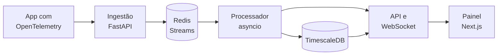

 

## 

Estudo Ciência da Computação na **Universidade Federal de Uberlândia** e construo sistemas de ponta a ponta: o back-end em Python, o front em React e Next.js com TypeScript, o banco, o deploy e os testes.

- 🔭 Agora construo o **TraceFlow**, uma plataforma de observabilidade em tempo real.
- ⚽ Nas horas vagas, cuido do **PRANCHETA 11**, um jogo de técnico de futebol com um motor de simulação calibrado contra o futebol real.
- 🧪 Gosto de projeto que dá para conferir: o PRANCHETA 11 tem mais de 400 testes e o AgendaKi tem 137.
- 🌱 Estudando agora: sistemas distribuídos, filas e bancos de séries temporais.

## 

### 📡 TraceFlow

Plataforma de observabilidade de aplicações: recebe traces pelo OpenTelemetry e mostra, ao vivo, as métricas de cada serviço, o mapa de dependências e os incidentes, com a causa provável e o raio de impacto. Um *playground* de caos injeta falhas para ver tudo acontecer. O pipeline é próprio, sem Prometheus nem Grafana:

## 

<table>
<tr>
<td width="50%" valign="top">

<h3>⚽ PRANCHETA 11</h3>

Jogo de técnico de futebol no navegador. O motor de simulação em Python é calibrado contra o futebol real: 40 divisões, 706 clubes, copas, seleções e multijogador em rede.

</td>
<td width="50%" valign="top">

<h3>🤖 ResolveAI</h3>

Help desk com IA: classifica e encaminha os chamados sozinho e sugere soluções com RAG, buscando casos parecidos no pgvector.

</td>
</tr>
<tr>
<td width="50%" valign="top">

<h3>📅 AgendaKi</h3>

Agendamento online para barbearias e salões: página do cliente, painel do dono, vários profissionais e avisos no celular.

</td>
<td width="50%" valign="top">

<h3>💸 PixCerto</h3>

Gera e confere cobranças Pix (BR Code) inteiramente no navegador. Não há back-end: a chave Pix nunca sai do aparelho.

</td>
</tr>
<tr>
<td width="50%" valign="top">

<h3>🔧 OS Fácil</h3>

Ordens de serviço para assistências técnicas e oficinas. Funciona offline com IndexedDB e sincroniza com o Supabase.

</td>
<td width="50%" valign="top">

<h3>🎥 Análise de jogadas</h3>

Visão computacional aplicada ao futebol: detecção e rastreamento de jogadores em vídeo. Feito para a seleção da Iniciação Científica X,Y Soccer IA.

</td>
</tr>
</table>

## 

**Linguagens**

**Back-end e dados**

**Front-end**

**Infra e testes**

## 

